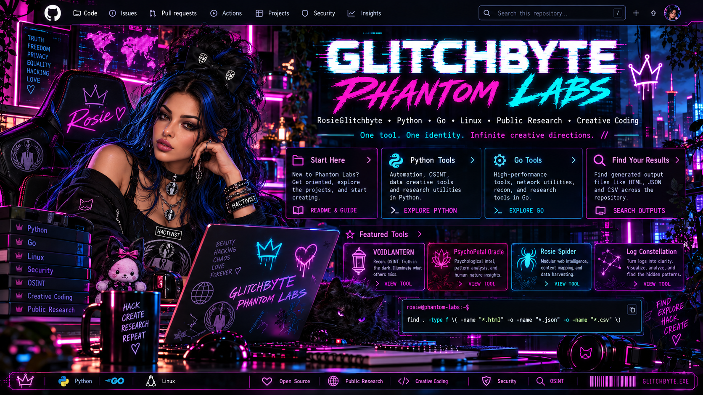

<div align="center">

# 🌹 GLITCHBYTE PHANTOM LABS

### 👻 ROSIEGLITCHBYTE // OFFICIAL COMMAND ECOSYSTEM



**PYTHON 3 · GO · UBUNTU/LINUX · PUBLIC INTELLIGENCE · CREATIVE CODE**


**One tool. One identity. Infinite creative directions.**

[**🕷️ PHANTOM TOOL VAULT**](docs/TOOL_VAULT.md) · [**🔍 ECOSYSTEM**](docs/ECOSYSTEM.md) · [**📚 START HERE**](docs/TOOL_STARTER_GUIDE.md) · [**🌹 ROSIE ARTWORK**](docs/ROSIE_VISUAL_STANDARD.md) · [**🛡️ SECURITY**](SECURITY.md)

</div>

```text
┏━━━━━━━━━━━━━━━━━━━━━━━━━━━━━━━━━━━━━━━━━━━━━━━━━━━━━━━━━━━━┓
┃   GLITCHBYTE // PHANTOM LABS :: OFFICIAL WORKSHOP          ┃
┣━━━━━━━━━━━━━━━━━━━━━━━━━━━━━━━━━━━━━━━━━━━━━━━━━━━━━━━━━━━━┫
┃   [✓] PYTHON TOOLS       [✓] GO DEVELOPMENT                 ┃
┃   [✓] PUBLIC RESEARCH    [✓] CREATIVE EXPERIMENTS          ┃
┃   [✓] README & GUIDES    [✓] TESTED RELEASE WORKFLOWS      ┃
┃                                                           ┃
┃   rosie@phantom-labs:~$ explore                            ┃
┃   > Build. Test. Run. Learn. █                              ┃
┗━━━━━━━━━━━━━━━━━━━━━━━━━━━━━━━━━━━━━━━━━━━━━━━━━━━━━━━━━━━━┛
```

## 💗 Welcome to the official ecosystem

This is **RosieGlitchbyte's GlitchByte Phantom Labs**, the next evolution of our original workshop. The existing repository, its full Git history, Python tools, Go projects, security rules and source-available license are retained.

Our creation standard: **each new project is original and independent**. We only remake or upgrade an existing creation when explicitly requested.

### 🕷️ Explore the workshop

| Station | Enter |
| --- | --- |
| 🧭 **START HERE** | [Setup, first run, and troubleshooting](docs/TOOL_STARTER_GUIDE.md) |
| 🕸️ **PHANTOM TOOL VAULT** | [Browse verified source links and tool spotlights](docs/TOOL_VAULT.md) |
| 🔍 **TOOL ECOSYSTEM** | [Browse every verified Python and Go project](docs/ECOSYSTEM.md) |
| 🐍 **PYTHON LAB** | [Python scripts, crawlers, research and creative code](tools/) |
| ⚙️ **GO LAB** | [VOIDLANTERN source, tests and build instructions](tools/go/voidlantern-go/) |
| 🌹 **ART & IDENTITY** | [Approved Rosie reference rules and official hero upload](docs/ROSIE_VISUAL_STANDARD.md) |
| 🔐 **SAFETY** | [Security guidance](SECURITY.md) and [release checklist](docs/RELEASE_CHECKLIST.md) |

## ⚡ Featured tools

| Name | Language | Use | Go to source |
| --- | --- | --- | --- |
| 👻 **VOIDLANTERN** | Go | Authorized HTTP, TLS and security-header diagnostics | [Tool spotlight](docs/tool-showcases/VOIDLANTERN.md) |
| ✨ **Log Constellation** | Python | Analyze local log events and reports | [Build recipe](docs/tool-showcases/LOG_CONSTELLATION.md) |
| 🌐 **GlitchByte Domain Intel** | Python | Research public domain information | [Build recipe](docs/tool-showcases/DOMAIN_INTEL.md) |
| 🕷️ **Rose Crawler** | Python | Public profile links and optional robots-aware metadata checks | [Build recipe](docs/tool-showcases/ROSE_CRAWLER.md) |
| 💗 **Rosie Username Intel** | Python | Public username research | [Build recipe](docs/tool-showcases/USERNAME_INTEL.md) |
| 🎮 **Rosie Catch Me Chaos** | Python | Creative coding and games | [Build recipe](docs/tool-showcases/CATCH_ME_IN_THE_CHAOS.md) |

These links point to **files present in this repository**, not merely concepts or local ZIP archives. Project maturity varies. View the [complete tool ecosystem](docs/ECOSYSTEM.md) for the rest.

## 🕵️ Featured Python build recipe

**Rosie Username Intel:** [Copy-and-paste Bash setup, offline links and JSON results](docs/tool-showcases/USERNAME_INTEL.md). A matching username is not proof of a shared identity.

## 🌱 Offline Python build recipe

**Rosie Signal Garden:** [Copy-and-paste setup, demo, HTML/JSON/CSV reports and troubleshooting](docs/tool-showcases/SIGNAL_GARDEN.md).

## 👻 Domain Phantom build recipe

**RosieGlitchByte Domain Phantom:** [Copy-and-paste setup, eight modes, JSON results and troubleshooting](docs/tool-showcases/DOMAIN_PHANTOM.md).

## 📡 IP Specter build recipe

**RosieGlitchByte IP Specter:** [Copy-and-paste offline-first setup, JSON results, authorized modules and troubleshooting](docs/tool-showcases/IP_SPECTER.md).

## 🌘 IP Shadow Scraper build recipe

**RosieGlitchByte IP Shadow Scraper:** [Copy-and-paste Ubuntu setup, nine modes, JSON output and troubleshooting](docs/tool-showcases/IP_SHADOW_SCRAPER.md).

## 🛰️ X Intel Phantom build recipe

**GlitchbyteRosie X Intel Phantom:** [Copy-and-paste Python setup, optional credential-aware X API run, JSON/CSV reports and troubleshooting](docs/tool-showcases/X_INTEL_PHANTOM.md).

## 🪞 X Shadow Intel No-API build recipe

**GlitchbyteRosie X Shadow Intel:** [Copy-and-paste offline Python setup, sample post analysis, JSON/CSV output and troubleshooting](docs/tool-showcases/X_SHADOW_NO_API.md).

## 💌 Ghost In My Heart build recipe

**Ghost In My Heart:** [Copy-and-paste installation, automated game smoke test, saved transcript and troubleshooting](docs/tool-showcases/GHOST_IN_MY_HEART.md).

## 🖤 Dark Desire build recipe

**RosieGlitchByte Dark Desire:** [Copy-and-paste Python setup, decoded love letter, animated run and troubleshooting](docs/tool-showcases/DARK_DESIRE.md).

## 💗 Find Me If You Love Me build recipe

**Rosie Hide Seek:** [Complete Python setup, actual three-gate game test, saved text transcript and troubleshooting](docs/tool-showcases/FIND_ME_IF_YOU_LOVE_ME.md).

## ⚡ Catch Me in the Chaos build recipe

**Catch Me in the Chaos:** [Copy-and-paste Python setup, three-lock game smoke test, saved transcript and troubleshooting](docs/tool-showcases/CATCH_ME_IN_THE_CHAOS.md).

## 🦋 HackGirl Intel build recipe

**RosieGlitchbyte HackGirl Intel:** [Copy-and-paste Python setup, offline sample CSV, JSON/HTML reporting and troubleshooting](docs/tool-showcases/HACKGIRL_INTEL.md).

## 🌺 Neon Rose Phantom 3.0 build recipe

**RosieGlitchByte Neon Rose Phantom 3.0:** [Copy-and-paste Python setup, eight real modes, safe offline sample, JSON report validation and troubleshooting](docs/tool-showcases/NEON_ROSE_PHANTOM_3.md).

## 🧪 Phase 20: Automatic tool-recipe audit

[Read the Tool Recipe Audit](docs/RECIPE_AUDIT.md). Our Python CI now checks that every existing tool has its own recipe page and that local Markdown links resolve. Documentation coverage is **not** the same as a completed Ubuntu end-to-end test.

## 💙 Phase 21: Real offline terminal verification

[See the successful Ubuntu GitHub Actions run and verification matrix](docs/OFFLINE_VERIFICATION.md). The suite executes real offline examples and checks report files and puzzle endings. Live API and authorized network testing remain separate; all full clone-and-build recipes are not yet individually fresh-machine certified.

## 🌹 Phase 22: All 17 copy-and-paste recipes verified on Ubuntu

[Read the clean-workspace recipe verification and successful CI run](docs/CLEAN_BUILD_VERIFICATION.md). Every published first-run Bash block completed in an isolated Ubuntu CI workspace. Git clone commands used a local checkout instead of public internet downloads; authorized live endpoints and API credentials were not used.

## 🌹 Phase 23: Public GitHub clone verified

[Read the successful real HTTPS clone, offline Python and Go release verification](docs/PUBLIC_CLONE_VERIFICATION.md). This complements the 17 clean-home recipes with an actual public GitHub download. Live API integrations are not included.

## 🛡️ Phase 24: Security and release readiness

[Read the security findings, corrected TLS verification policy, and remaining release gates](docs/RELEASE_READINESS_REVIEW.md). Offline validation is verified; authorized live integration and a full security review remain outstanding.

## 🌹 Phase 25: Artwork and report reliability

[Read the Phase 25 fixes and regression-test details](docs/PHASE25_RELIABILITY.md). Rosie IP Shadow Scraper now locates approved art; it and Rose Crawler avoid overwriting rapid reports and preserve dotted handles.

## 🌹 Final workshop handoff: Offline foundation verified

[Read the completed workshop handoff and remaining release gates](docs/WORKSHOP_HANDOFF.md). The original 17 tools have independent recipes and passing offline Ubuntu checks; credentials, live integration, artwork redistribution rights, and a full security audit are still separate approvals.

## ⚡ New independent workstation: HEXWAKE Palette Foundry

**Create fresh Glitch HEX palettes with reproducible color seeds, RGB-shift parameters and a beautiful offline HTML gallery.** [Explore HEXWAKE and copy its complete Ubuntu build recipe](docs/tool-showcases/HEXWAKE.md). [See the standalone Python code](tools/hexwake_palette_foundry.py).

This is a brand-new creative tool, independent of the 17 preserved original projects. No API keys, website requests or login credentials.

## 🚀 Quick-start terminal

Clone the public repository:

```bash
git clone https://github.com/Hellfire13666/glitchbyte-phantom-labs.git
cd glitchbyte-phantom-labs
```

Find tools:

```bash
find tools -type f \( -name '*.py' -o -name 'go.mod' \) | sort
```

For Python, look at individual tool help and instructions:

```bash
python3 tools/glitchbyte_log_constellation.py --help
```

To build VOIDLANTERN:

```bash
cd tools/go/voidlantern-go
go test ./...
go vet ./...
go build -o voidlantern .
./voidlantern -url https://example.com -out reports/example.json
```

Read the [starter guide](docs/TOOL_STARTER_GUIDE.md) if `requirements.txt` or the working directory isn't found. Some scripts require optional packages or network access; don't assume all use the same arguments.

## 📊 Find your HTML, JSON and CSV results

From the directory where you ran a tool:

```bash
find . -type f \( -name "*.html" -o -name "*.json" -o -name "*.csv" \)
```

This lists local report files, **not live public web links**. It may show no output until a tool finishes and writes a report.

## 🧪 Build • Test • Run: our development standard

Every **new** creation should have independent names and report paths, a useful README, specific build/test/run examples, honest test status and live site-by-site progress where practical. We prioritize free permitted public sources; identity matches are never assumed from a matching username alone.

Run repository-level Python checks:

```bash
python3 -m compileall -q tools
python3 -m unittest discover -s tests -v
```

Go projects should be tested and built **inside their individual module folders**. See [the full standards and examples](docs/TOOL_STARTER_GUIDE.md).

## 🌹 Rosie is the face of the workshop

Our official Rosie has **brown eyes, dark hair with electric-blue highlights, and established special-face variants**. We use approved references rather than introducing an unfamiliar replacement.

Our approved Rosie hero artwork is uploaded as [`artwork/labface2.png`](artwork/labface2.png) and displayed at the top of this homepage. [Artwork and character standards](docs/ROSIE_VISUAL_STANDARD.md).

## 🔐 Ownership, licenses and security

**Published and attributed to RosieGlitchbyte.**

Copyright © 2026 RosieGlitchbyte, to the extent applicable. This repository has a **custom source-available license**, not an unrestricted open-source license. Review [LICENSE-NOTICE.md](LICENSE-NOTICE.md) before redistributing or modifying source code. AI-assisted content may not be copyright-protectable in every jurisdiction.

The repository is publicly accessible, but the legacy tool collection is a **preservation/release-candidate archive**. Syntax tests and limited unit tests do not prove full live functionality or security auditing. Consult [SECURITY.md](SECURITY.md) and [docs/RELEASE_CHECKLIST.md](docs/RELEASE_CHECKLIST.md). Do not publish credentials, tokens, browser cookies, sensitive reports, or private data.

---

<div align="center">

**🌹 GLITCHBYTE PHANTOM LABS**

*Built in the shadows. Preserved in the code.*

</div>
