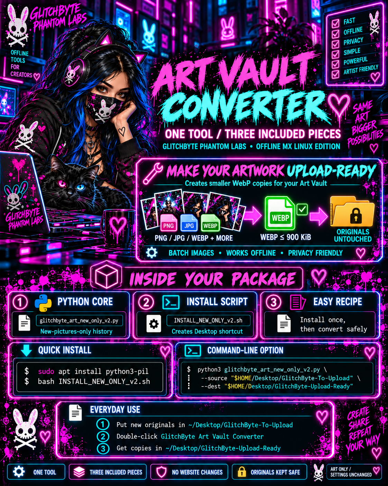

<!-- GLITCHBYTE-UPLOAD-DOOR:START -->
<div align="right"><a href="https://github.com/Hellfire13666/glitchbyte-phantom-labs/upload/main"></a></div>
<!-- GLITCHBYTE-UPLOAD-DOOR:END -->

<!-- GLITCHBYTE-VISITOR-BADGE:START -->
[](https://github.com/Hellfire13666/glitchbyte-phantom-labs)
<!-- GLITCHBYTE-VISITOR-BADGE:END -->


> 🎨 **NEW · CREATIVE UTILITIES:** [GlitchByte Art Vault Converter and Share Card Doctor](docs/CREATIVE_UTILITIES.md) are **TWO distinct tools**. Art Vault's compression, Desktop launcher, and new-only v2 behavior are **three components of the same converter**, not three tools. Existing tools and Hangout member data are untouched.

<details open>
<summary><strong>🎨 See the two approved Creative Utilities covers</strong></summary>


<table>
<tr>
<td width="50%" valign="top">
<a href="docs/creative-utilities-showcase-v1.0.3/01-FACEBOOK-SHARING-DEBUGGER/assets/APPROVED-FACEBOOK-SHARING-DEBUGGER.png"></a>
<p><strong>Facebook Sharing Debugger</strong><br>Meta's external link-preview cache tool; paired with our read-only Share Card Doctor.</p>
</td>
<td width="50%" valign="top">
<a href="docs/creative-utilities-showcase-v1.0.3/02-ART-VAULT-CONVERTER/assets/ART-VAULT-CONVERTER-ROSIE-NEON-v2.png"></a>
<p><strong>Art Vault Converter v2</strong><br>Offline Debian-based Linux WebP optimizer with saved new-picture history. One converter, three project components.</p>
</td>
</tr>
</table>

[Browse the approved two-page artwork and instructions](docs/creative-utilities-showcase-v1.0.3/README.md) · [Phantom Tool Vault](docs/TOOL_VAULT.md)

</details>

<!-- GLITCHBYTE-MASTER-HUB:START -->
> 🌹 **MASTER HUB v0.2.0 · ROSIE SWITCHBOARD · PUBLISHED** | [Download official release](https://github.com/Hellfire13666/glitchbyte-phantom-labs/releases/tag/master-hub-v0.2.0) · [One-paste installation + XFCE desktop steps](docs/MASTER_HUB_PUBLIC_INSTALL.md) · [Future tool registration](docs/MASTER_HUB_TOOL_REGISTRATION.md) · [Release verification](docs/MASTER_HUB_PUBLIC_RELEASE.md). This is an **offline local HTML hub**, not a remotely hosted application. The installer preserves previous versions and independently installed tools.

**🐧 ONE-SQUARE LINUX INSTALL** (review the [installer source](scripts/install_glitchbyte_master_hub_v020.sh) before running it):
```bash
tmp="$(mktemp)" && curl -fsSL --proto '=https' --tlsv1.2 \
  'https://raw.githubusercontent.com/Hellfire13666/glitchbyte-phantom-labs/main/scripts/install_glitchbyte_master_hub_v020.sh' \
  -o "$tmp" && bash "$tmp"; result=$?; rm -f -- "$tmp"; test "$result" -eq 0
```
<!-- GLITCHBYTE-MASTER-HUB:END -->

<div align="center">

# 🌹 GLITCHBYTE PHANTOM LABS HQ

### 👻 ROSIEGLITCHBYTE // ORIGINAL HEADQUARTERS


**PYTHON 3 · GO · UBUNTU/LINUX · PUBLIC INTELLIGENCE · CREATIVE CODE**


**One tool. One identity. Infinite creative directions.**


**📦 EVERY FUTURE BUILD:** Follow the [Build → Run → Publish → Vault standard](docs/BUILD_PUBLICATION_STANDARD.md). Unique tools, colorful real-time output, optional saving for new terminal-first builds, tested Simple/Medium/Extra recipes, and verified links across our hubs.

**🌈 NEW FOR BEGINNERS:** [SIMPLE · MEDIUM · EXTRA runtime recipes](docs/BEGINNER_RUNTIME_RECIPES.md) show exactly how to run tools, read real terminal findings, understand timeouts, and choose optional file saving. These are documentation examples, not universal flags.

[**👻 PHANTOM LABS HQ**](https://github.com/Hellfire13666/glitchbyte-phantom-labs) · [**🕷️ PHANTOM TOOL VAULT**](docs/TOOL_VAULT.md) · [**🔐 PHANTOM BACKUP HQ**](https://github.com/Hellfire13666/glitchbyte-phantom-labs-releases) · [**🔍 ECOSYSTEM**](docs/ECOSYSTEM.md) · [**📚 START HERE**](docs/TOOL_STARTER_GUIDE.md) · [**🌹 ROSIE ARTWORK**](docs/ROSIE_VISUAL_STANDARD.md) · [**🛡️ SECURITY**](SECURITY.md)

</div>

```text
┏━━━━━━━━━━━━━━━━━━━━━━━━━━━━━━━━━━━━━━━━━━━━━━━━━━━━━━━━━━━━┓
┃   GLITCHBYTE // PHANTOM LABS :: OFFICIAL WORKSHOP          ┃
┣━━━━━━━━━━━━━━━━━━━━━━━━━━━━━━━━━━━━━━━━━━━━━━━━━━━━━━━━━━━━┫
┃   [✓] PYTHON TOOLS       [✓] GO DEVELOPMENT                 ┃
┃   [✓] PUBLIC RESEARCH    [✓] CREATIVE EXPERIMENTS          ┃
┃   [✓] README & GUIDES    [✓] TESTED RELEASE WORKFLOWS      ┃
┃                                                           ┃
┃   rosie@phantom-labs:~$ explore                            ┃
┃   > Build. Test. Run. Learn. █                              ┃
┗━━━━━━━━━━━━━━━━━━━━━━━━━━━━━━━━━━━━━━━━━━━━━━━━━━━━━━━━━━━━┛
```

**🌹⚡ [Mandatory Build Charter](docs/PHANTOM_LABS_MANDATORY_BUILD_CHARTER.md)** · Our permanent standard for **every new tool's own GitHub repository, own tool page, artwork, Glitch HEX identity, colorful code/output, SIMPLE/MEDIUM/EXTRA Ubuntu examples, safe saving, verification, launchers, versioned packages, upload doors and tested recovery**. [Cultivation Room](docs/CULTIVATION_ROOM.md) tracks new builds. Published tools and prototypes are listed separately so no unfinished project is misrepresented as released.

**🌹 [RIFTSEAL v1.0.0](docs/tool-showcases/RIFTSEAL.md):** two finished offline SHA-256 utilities, custom artwork and documented SIMPLE/MEDIUM/EXTRA Ubuntu commands. Release ZIP integrity and **16/16** offline tests verified; **dedicated GitHub source repo is still pending**. The downloadable source-only ZIP and checksum were delivered to the owner in ChatGPT. Next Cultivation Room goal after the break: RootSignal Cultivator.

## 💗 Welcome to Phantom Labs HQ

This is **RosieGlitchbyte's original Phantom Labs HQ**, the home base of GlitchByte Phantom Labs and the next evolution of our original workshop. The existing repository, its full Git history, Python tools, Go projects, security rules and source-available license are retained.

Our creation standard: **each new project is original and independent**. We only remake or upgrade an existing creation when explicitly requested.

Our three official destinations are **Phantom Labs HQ** (the original workshop and project home), **[Phantom Tool Vault](docs/TOOL_VAULT.md)** (the tool index), and **[Phantom Backup HQ](https://github.com/Hellfire13666/glitchbyte-phantom-labs-releases)** (versioned backup and recovery archives). The **Cultivation Room** and **RosieRiot Overdrive** remain our specialized laboratories. Repository names, source files, and upload doors stay unchanged.

### 🕷️ Explore the workshop

| Station | Enter |
| --- | --- |
| 👻 **PHANTOM LABS HQ** | You are at our original main headquarters, with all workshop directions below |
| 🔐 **PHANTOM BACKUP HQ** | [Recovery archives, SHA-256 manifests and restore guide](https://github.com/Hellfire13666/glitchbyte-phantom-labs-releases) |
| 🧭 **START HERE** | [Setup, first run, and troubleshooting](docs/TOOL_STARTER_GUIDE.md) |
| 🕸️ **PHANTOM TOOL VAULT** | [Browse verified source links and tool spotlights](docs/TOOL_VAULT.md) |
| 🔍 **TOOL ECOSYSTEM** | [Browse every verified Python and Go project](docs/ECOSYSTEM.md) |
| 🐍 **PYTHON LAB** | [Python scripts, crawlers, research and creative code](tools/) |
| ⚙️ **GO LAB** | [VOIDLANTERN source, tests and build instructions](tools/go/voidlantern-go/) |
| 🌹 **ART & IDENTITY** | [Approved Rosie reference rules and official hero upload](docs/ROSIE_VISUAL_STANDARD.md) |
| 🔐 **SAFETY** | [Security guidance](SECURITY.md) and [release checklist](docs/RELEASE_CHECKLIST.md) |

**💾 NEW EASY SAVE:** SUBDOMINATRIX now supports `-o names.txt` to save only the discovered hostname candidates, one per line, while colorful live terminal output continues. Omit `-o` in `--terminal-only` mode for no saved reports. Full Firefox/HTML reports remain available in legacy mode. [Copy-and-paste instructions](docs/tool-showcases/SUBDOMINATRIX.md).

**✅ Real Ubuntu Easy Save check:** using `--o findomain_results.txt -- findomain -t facebook.com`, the shared launcher displayed live findings and reported a saved TXT transcript after the third-party Findomain command finished in **21 seconds**. The crt.sh provider needed an API fallback, but the overall run finished. [Exact setup and output caveats](docs/EASY_SAVE_ALL_TOOLS.md).

**Triad field result:** The separate companion ran in Ubuntu and correctly reported Amass timeout (65s/0 accepted names), GAU timeout (50s/0 URLs), Waybackurls exit 0 with no results (0.87s), and a requested empty `triad_check2.txt`. This verifies the orchestration, status reporting, and optional saving, **not** successful data retrieval from every external source. An earlier direct Waybackurls test produced 20 URL lines. [Details and exact boundaries](docs/integrations/TRIAD_SIGNAL_2026.md).

## 🌹⚡ TRIAD SIGNAL: Bounded Triad Forge companion

Your Ubuntu inspection confirmed an existing local Triad Forge archive and all three installed tools. In the first live test, Waybackurls completed with **20 URL lines**, while passive Amass and GAU each reached the **45-second time limit**. [**Triad Signal runtime companion**](scripts/triad_signal_2026.py) offers independent parallel time budgets, truthful partial/timeout reporting, colored live candidates and opt-in `-o`/`--o` TXT results. [Beginner Simple/Medium/Extra commands and observed status](docs/integrations/TRIAD_SIGNAL_2026.md). It does not replace or modify the local Forge ZIP. Field testing of the companion itself is still pending.

## 💾 Easy-save commands throughout Phantom Labs

Every published tool guide now links to [Easy Save for Every Tool](docs/EASY_SAVE_ALL_TOOLS.md). Our standard is `-o name.txt` or `--o name.txt`: native result TXT on updated tools such as SUBDOMINATRIX, or the [shared transcript saver](scripts/phantom_easy_save.py) for legacy CLI tools. The runner keeps colorful output on screen, strips terminal color codes from its TXT file, and never overwrites an existing one. It does **not** suppress reports a legacy program already creates. Interactive tools and browser interfaces may need their own export. [Tool Vault](docs/TOOL_VAULT.md) · [Publishing standard](docs/BUILD_PUBLICATION_STANDARD.md).

## 🌹⚡ SUBDOMINATRIX: Live Signal upgrade

**October 19 Findomain integration fix:** the live terminal upgrade now has an independent `--cli-timeout` (default 60s), streams optional CLI findings, preserves partial results and explains errors instead of hiding them. Python CI and public-clone checks passed. [Updated instructions](docs/tool-showcases/SUBDOMINATRIX.md). The live Ubuntu retest passed: 151 unique candidate hostnames, 102 Findomain records in 40.45 seconds, and exactly one explicitly requested TXT report.


**New terminal-first mode, published and CI-tested:** `--terminal-only --color always` displays real public-source candidates as each provider finishes, visible timeouts and HTTP 429 cooldown feedback, and **does not write reports or open Firefox**. The familiar local Firefox dashboard/report mode remains available by omitting `--terminal-only`. [Source](tools/subdominatrix.py) · [Simple / Medium / Extra launch recipes](docs/tool-showcases/SUBDOMINATRIX.md). Live performance on the user's Ubuntu machine still requires its own check.

## 🌐 Findomain: successful live discovery

**Checklist #2 passed:** our installed Findomain showed real public-source hostname candidates in a 23-second Ubuntu run. Read the [Findomain Simple / Medium / Extra recipes, path diagnosis, and optional save notes](docs/integrations/FINDOMAIN_LIVE_CHECK.md). Findomain is a third-party executable, not another GlitchByte-owned tool.

## 🌹 New: ROSIE PHANTOM SCAN V2

Explore public DNS, HTTPS certificate, security-header observations, RDAP/WHOIS and opt-in crt.sh/Findomain discovery in a Rosie-branded Firefox dashboard. [Open the full Ubuntu recipe](docs/tool-showcases/ROSIE_PHANTOM_SCAN_V2.md) · [View original Python 3 source](tools/rosie_phantom_scan_v2.py). Includes safe offline preview. Public-data observations are not proof of identity or vulnerabilities.

## 🌹 NEW: GHOSTMARK Integrity Atlas

**Your files, mapped in neon.** Make a read-only SHA-256 snapshot of a local folder, find identical-content duplicates, compare it with a saved baseline, and open a Rosie-styled Firefox dashboard. No uploads, network scanning, deletions, or external dependencies. [Open the Ubuntu recipe](docs/tool-showcases/GHOSTMARK.md) · [Python 3 source](tools/ghostmark_integrity_atlas.py). 

## 🖥️ IMPORTANT: How to launch these tools

**GitHub links open tool pages, not applications.** To actually run a tool and open its HTML dashboard in Firefox, go to [Copy, Paste & Open](docs/COPY_PASTE_OPEN.md), copy the **whole Bash block** for the tool, paste it into an Ubuntu/Linux **Terminal**, and press **Enter**. The launcher prints a saved local `[REPORT]` HTML path and opens Firefox where available. Typing `hexwake` or `cipherbox` alone does not work: these are not installed shell commands. If Firefox doesn't open, try `firefox https://example.com` and follow the [terminal troubleshooting instructions](docs/COPY_PASTE_OPEN.md#-how-visitors-actually-trigger-a-tool). A GitHub web page cannot directly start software on a visitor's device.

## 🌹⚡ Copy, Paste & Open in Firefox

**Don't want to download chat attachments or fight Git merge errors?** [Open our Quick Launch page](docs/COPY_PASTE_OPEN.md) for single-paste terminal commands that fetch only our published lab scripts and automatically open generated HTML in Firefox. Launchers are available for **HEXWAKE, CIPHERBOX, ROSIE PHANTOM SCAN V2, GHOSTMARK and SUBDOMINATRIX**, with safe local demo defaults. They install into a separate home folder, never modify your existing checkout, and print saved report paths if Firefox isn't available.

[**📋 COPY & PASTE OPEN: FOUR WORKING COMMANDS**](docs/COPY_PASTE_OPEN.md) · [**🐍 Launcher source**](scripts/phantom_quickopen.py)

## 🌹👻 SUBDOMINATRIX: Subdomain Intelligence Riot

**New RosieGlitchbyte subdomain recon workstation, built as real Python 3 code instead of relying on mock artwork.** Gather passive records from crt.sh, AlienVault OTX, HackerTarget and urlscan.io; optionally call installed Subfinder and Findomain; perform **opt-in** bounded DNS and HTTPS header observations; and save a search-ready neon HTML dashboard, CSV, JSON and TXT. Offline synthetic previews work without any internet lookup.

[**🐍 Subdominatrix source**](tools/subdominatrix.py) · [**📋 Actual Ubuntu recipe and honest feature checklist**](docs/tool-showcases/SUBDOMINATRIX.md) · [**⚡ Single-paste Firefox launcher**](docs/COPY_PASTE_OPEN.md#-subdominatrix--real-subdomain-intelligence-feedback)

**The SUBDOMINATRIX promo image is a concept**: its illustrated global maps, screenshots, numbers and imagined commands are not real output from this tool. Live data sources may be unavailable or rate-limited. The chosen artwork will need its image asset committed separately to display that exact poster here.

## 🌹 NEW: VELVETECHO Persona Observatory

**GlitchByte colorful signal workstation.** Offline public username candidate links, optional authorized live site checks, and a local masked phone-number format scanner. Vibrant neon outcome readouts and local HTML/CSV/JSON reports. [Open the dedicated Ubuntu guide](docs/tool-showcases/VELVETECHO.md) · [Python source](tools/velvetecho-persona-observatory/velvetecho_persona_observatory.py) · [Tool Vault](docs/TOOL_VAULT.md).

## ⚡ Featured tools

| Name | Language | Use | Go to source |
| --- | --- | --- | --- |
| 👻 **VOIDLANTERN** | Go | Authorized HTTP, TLS and security-header diagnostics | [Tool spotlight](docs/tool-showcases/VOIDLANTERN.md) |
| ✨ **Log Constellation** | Python | Analyze local log events and reports | [Build recipe](docs/tool-showcases/LOG_CONSTELLATION.md) |
| 🌐 **GlitchByte Domain Intel** | Python | Research public domain information | [Build recipe](docs/tool-showcases/DOMAIN_INTEL.md) |
| 🕷️ **Rose Crawler** | Python | Public profile links and optional robots-aware metadata checks | [Build recipe](docs/tool-showcases/ROSE_CRAWLER.md) |
| 💗 **Rosie Username Intel** | Python | Public username research | [Build recipe](docs/tool-showcases/USERNAME_INTEL.md) |
| 🎮 **Rosie Catch Me Chaos** | Python | Creative coding and games | [Build recipe](docs/tool-showcases/CATCH_ME_IN_THE_CHAOS.md) |

These links point to **files present in this repository**, not merely concepts or local ZIP archives. Project maturity varies. View the [complete tool ecosystem](docs/ECOSYSTEM.md) for the rest.

## 🕵️ Featured Python build recipe

**Rosie Username Intel:** [Copy-and-paste Bash setup, offline links and JSON results](docs/tool-showcases/USERNAME_INTEL.md). A matching username is not proof of a shared identity.

## 🌱 Offline Python build recipe

**Rosie Signal Garden:** [Copy-and-paste setup, demo, HTML/JSON/CSV reports and troubleshooting](docs/tool-showcases/SIGNAL_GARDEN.md).

## 👻 Domain Phantom build recipe

**RosieGlitchByte Domain Phantom:** [Copy-and-paste setup, eight modes, JSON results and troubleshooting](docs/tool-showcases/DOMAIN_PHANTOM.md).

## 📡 IP Specter build recipe

**RosieGlitchByte IP Specter:** [Copy-and-paste offline-first setup, JSON results, authorized modules and troubleshooting](docs/tool-showcases/IP_SPECTER.md).

## 🌘 IP Shadow Scraper build recipe

**RosieGlitchByte IP Shadow Scraper:** [Copy-and-paste Ubuntu setup, nine modes, JSON output and troubleshooting](docs/tool-showcases/IP_SHADOW_SCRAPER.md).

## 🛰️ X Intel Phantom build recipe

**GlitchbyteRosie X Intel Phantom:** [Copy-and-paste Python setup, optional credential-aware X API run, JSON/CSV reports and troubleshooting](docs/tool-showcases/X_INTEL_PHANTOM.md).

## 🪞 X Shadow Intel No-API build recipe

**GlitchbyteRosie X Shadow Intel:** [Copy-and-paste offline Python setup, sample post analysis, JSON/CSV output and troubleshooting](docs/tool-showcases/X_SHADOW_NO_API.md).

## 💌 Ghost In My Heart build recipe

**Ghost In My Heart:** [Copy-and-paste installation, automated game smoke test, saved transcript and troubleshooting](docs/tool-showcases/GHOST_IN_MY_HEART.md).

## 🖤 Dark Desire build recipe

**RosieGlitchByte Dark Desire:** [Copy-and-paste Python setup, decoded love letter, animated run and troubleshooting](docs/tool-showcases/DARK_DESIRE.md).

## 💗 Find Me If You Love Me build recipe

**Rosie Hide Seek:** [Complete Python setup, actual three-gate game test, saved text transcript and troubleshooting](docs/tool-showcases/FIND_ME_IF_YOU_LOVE_ME.md).

## ⚡ Catch Me in the Chaos build recipe

**Catch Me in the Chaos:** [Copy-and-paste Python setup, three-lock game smoke test, saved transcript and troubleshooting](docs/tool-showcases/CATCH_ME_IN_THE_CHAOS.md).

## 🦋 HackGirl Intel build recipe

**RosieGlitchbyte HackGirl Intel:** [Copy-and-paste Python setup, offline sample CSV, JSON/HTML reporting and troubleshooting](docs/tool-showcases/HACKGIRL_INTEL.md).

## 🌺 Neon Rose Phantom 3.0 build recipe

**RosieGlitchByte Neon Rose Phantom 3.0:** [Copy-and-paste Python setup, eight real modes, safe offline sample, JSON report validation and troubleshooting](docs/tool-showcases/NEON_ROSE_PHANTOM_3.md).

## 🧪 Phase 20: Automatic tool-recipe audit

[Read the Tool Recipe Audit](docs/RECIPE_AUDIT.md). Our Python CI now checks that every existing tool has its own recipe page and that local Markdown links resolve. Documentation coverage is **not** the same as a completed Ubuntu end-to-end test.

## 💙 Phase 21: Real offline terminal verification

[See the successful Ubuntu GitHub Actions run and verification matrix](docs/OFFLINE_VERIFICATION.md). The suite executes real offline examples and checks report files and puzzle endings. Live API and authorized network testing remain separate; all full clone-and-build recipes are not yet individually fresh-machine certified.

## 🌹 Phase 22: All 17 copy-and-paste recipes verified on Ubuntu

[Read the clean-workspace recipe verification and successful CI run](docs/CLEAN_BUILD_VERIFICATION.md). Every published first-run Bash block completed in an isolated Ubuntu CI workspace. Git clone commands used a local checkout instead of public internet downloads; authorized live endpoints and API credentials were not used.

## 🌹 Phase 23: Public GitHub clone verified

[Read the successful real HTTPS clone, offline Python and Go release verification](docs/PUBLIC_CLONE_VERIFICATION.md). This complements the 17 clean-home recipes with an actual public GitHub download. Live API integrations are not included.

## 🛡️ Phase 24: Security and release readiness

[Read the security findings, corrected TLS verification policy, and remaining release gates](docs/RELEASE_READINESS_REVIEW.md). Offline validation is verified; authorized live integration and a full security review remain outstanding.

## 🌹 Phase 25: Artwork and report reliability

[Read the Phase 25 fixes and regression-test details](docs/PHASE25_RELIABILITY.md). Rosie IP Shadow Scraper now locates approved art; it and Rose Crawler avoid overwriting rapid reports and preserve dotted handles.

## 🌹 Final workshop handoff: Offline foundation verified

[Read the completed workshop handoff and remaining release gates](docs/WORKSHOP_HANDOFF.md). The original 17 tools have independent recipes and passing offline Ubuntu checks; credentials, live integration, artwork redistribution rights, and a full security audit are still separate approvals.

## ⚡ New independent workstation: HEXWAKE Palette Foundry

**Create fresh Glitch HEX palettes with reproducible color seeds, RGB-shift parameters and a beautiful offline HTML gallery.** [Explore HEXWAKE and copy its complete Ubuntu build recipe](docs/tool-showcases/HEXWAKE.md). [See the standalone Python code](tools/hexwake_palette_foundry.py).

This is a brand-new creative tool, independent of the 17 preserved original projects. No API keys, website requests or login credentials.

## 🗝️ PHANTOM CIPHERBOX: Independent codebreaking workshop

[Create your own genuine reversible Python puzzles, with a printable HTML transmission, ordered clues, a local-only answer key and answer validation](docs/tool-showcases/PHANTOM_CIPHERBOX.md). [View Python source](tools/phantom_cipherbox.py). This is creative encoding, **not secure encryption**; no API, third-party account or network access is involved after a checkout.

## 🚀 Quick-start terminal

Clone the public repository:

```bash
git clone https://github.com/Hellfire13666/glitchbyte-phantom-labs.git
cd glitchbyte-phantom-labs
```

Find tools:

```bash
find tools -type f \( -name '*.py' -o -name 'go.mod' \) | sort
```

For Python, look at individual tool help and instructions:

```bash
python3 tools/glitchbyte_log_constellation.py --help
```

To build VOIDLANTERN:

```bash
cd tools/go/voidlantern-go
go test ./...
go vet ./...
go build -o voidlantern .
./voidlantern -url https://example.com -out reports/example.json
```

Read the [starter guide](docs/TOOL_STARTER_GUIDE.md) if `requirements.txt` or the working directory isn't found. Some scripts require optional packages or network access; don't assume all use the same arguments.

## 📊 Find your HTML, JSON and CSV results

From the directory where you ran a tool:

```bash
find . -type f \( -name "*.html" -o -name "*.json" -o -name "*.csv" \)
```

This lists local report files, **not live public web links**. It may show no output until a tool finishes and writes a report.

## 🧪 Build • Test • Run: our development standard

Every **new** creation should have independent names and report paths, a useful README, specific build/test/run examples, honest test status and live site-by-site progress where practical. We prioritize free permitted public sources; identity matches are never assumed from a matching username alone.

Run repository-level Python checks:

```bash
python3 -m compileall -q tools
python3 -m unittest discover -s tests -v
```

Go projects should be tested and built **inside their individual module folders**. See [the full standards and examples](docs/TOOL_STARTER_GUIDE.md).

## 🌹 Rosie is the face of the workshop

Our official Rosie has **brown eyes, dark hair with electric-blue highlights, and established special-face variants**. We use approved references rather than introducing an unfamiliar replacement.

Our approved Rosie hero artwork is uploaded as [`artwork/labface2.png`](artwork/labface2.png) and displayed at the top of this homepage. [Artwork and character standards](docs/ROSIE_VISUAL_STANDARD.md).

## 🔐 Ownership, licenses and security

**Published and attributed to RosieGlitchbyte.**

Copyright © 2026 RosieGlitchbyte, to the extent applicable. This repository has a **custom source-available license**, not an unrestricted open-source license. Review [LICENSE-NOTICE.md](LICENSE-NOTICE.md) before redistributing or modifying source code. AI-assisted content may not be copyright-protectable in every jurisdiction.

The repository is publicly accessible, but the legacy tool collection is a **preservation/release-candidate archive**. Syntax tests and limited unit tests do not prove full live functionality or security auditing. Consult [SECURITY.md](SECURITY.md) and [docs/RELEASE_CHECKLIST.md](docs/RELEASE_CHECKLIST.md). Do not publish credentials, tokens, browser cookies, sensitive reports, or private data.

---

<div align="center">

**🌹 GLITCHBYTE PHANTOM LABS HQ**

*Built in the shadows. Preserved in the code.*

</div>


## ✦ SCREAMFRAME: Pixel Autopsy Studio

An independent offline screenshot intelligence workstation. Find exact copies (SHA-256), visual lookalikes (dHash), image-format mismatches and limited EXIF timestamps, then open a radioactive-lime-and-signal-orange local HTML gallery. The tool is read-only and never uploads images; metadata is not proof of image forgery. [Ubuntu recipe](docs/tool-showcases/SCREAMFRAME.md) · [Python source](tools/screamframe-pixel-autopsy/screamframe_pixel_autopsy.py) · [8 local tests](tools/screamframe-pixel-autopsy/tests/test_screamframe_pixel_autopsy.py).

<!-- GLITCHBYTE LAB NAV START -->
## 🧭 GLITCHBYTE LAB DOORS

| Destination | Go to page | Upload files |
| --- | --- | --- |
| 👻 **Phantom Labs HQ** | [Main headquarters](https://github.com/Hellfire13666/glitchbyte-phantom-labs) | [📤 HQ upload door](https://github.com/Hellfire13666/glitchbyte-phantom-labs/upload/main) |
| 🌱 **Cultivation Room** | [Building lab](https://github.com/Hellfire13666/glitchbyte-phantom-labs/blob/main/docs/CULTIVATION_ROOM.md) | [📤 Build lab upload door](https://github.com/Hellfire13666/glitchbyte-phantom-labs/upload/main) |
| ⚡ **RosieRiot Overdrive** | [Tool repository](https://github.com/Hellfire13666/rosieriot-overdrive-2026) · [Lab page](https://github.com/Hellfire13666/glitchbyte-phantom-labs/blob/main/docs/ROSIERIOT_OVERDRIVE_LAB.md) | [📤 Overdrive upload door](https://github.com/Hellfire13666/rosieriot-overdrive-2026/upload/main) |
| 🔐 **Phantom Backup HQ** | [Verified recovery archives](https://github.com/Hellfire13666/glitchbyte-phantom-labs-releases) | [📤 Vault upload door](https://github.com/Hellfire13666/glitchbyte-phantom-labs-releases/upload/main) |

> The Cultivation Room currently shares the headquarters repository upload door. Keep dated offline backups; never upload credentials or private reports into public GitHub repositories.

<!-- GLITCHBYTE LAB NAV END -->
