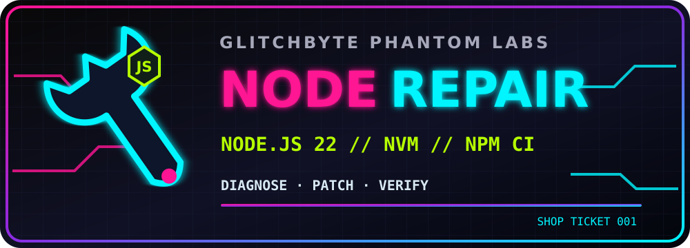

# 🧰 GLITCHBYTE PHANTOM LABS // REPAIR SHOP

**Linux environment recovery · reproducible fixes · no guessing.**

[← Phantom Tool Vault](../TOOL_VAULT.md) · [Phantom Labs HQ](../../README.md)

This shop stores **observed, documented repairs** for local tool installations and runtime problems. These are repair recipes, **not** additional original Phantom Labs tools. Each recipe states the symptoms, root cause, safe fix, observed results, and limits.

| Repair ticket | System / symptom | State |
| --- | --- | --- |
| [NODE-2026-001: MXHX Shed / Node 0.10 → Node 22](NODE22_MXHX_SHED.md) | MX Linux (Debian Trixie); ancient nvm-selected Node.js fails modern ES modules and npm installation | **Field-tested: Node 22, npm ci, and Vite startup passed** |

## Repair shop rules

1. **Diagnose first.** Capture failing command, runtime versions and relevant errors without passwords, secrets or private data.
2. **Preserve existing tools.** No blanket system reinstall, sudo npm, deletion of source directories, or overwriting other projects.
3. **Repair narrowly.** Use a version manager when possible and the Node version the project actually requires.
4. **Separate pass levels.** Dependency installation, server startup and every browser/tool feature are different checks.
5. **Document truthful status.** A running Vite server does not certify every function or remote integration.

**Next repairs:** use a uniquely named ticket in this directory, and add a new doorway to the table without overwriting older tickets.
