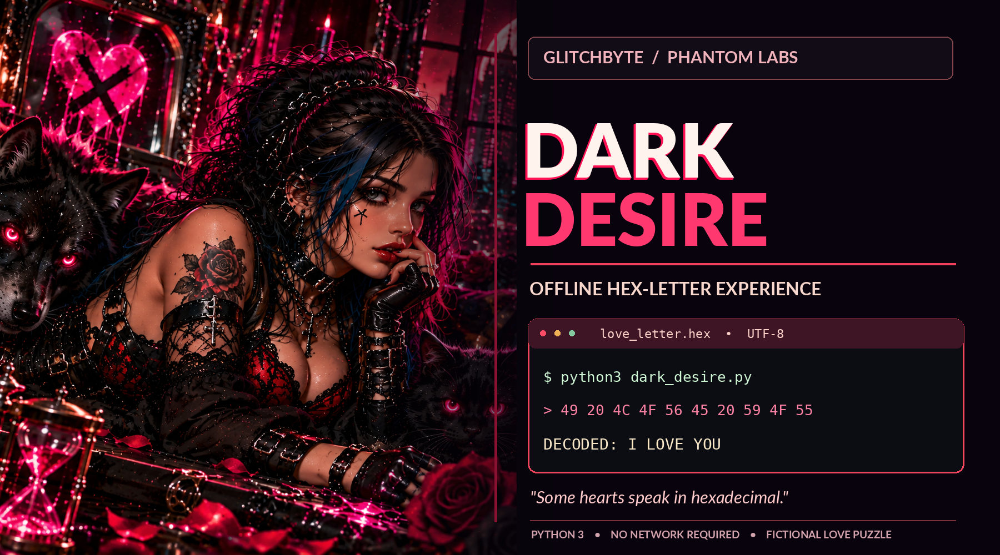

<!-- GLITCHBYTE-UPLOAD-DOOR:START -->
<div align="right"><a href="https://github.com/Hellfire13666/glitchbyte-phantom-labs/upload/main"></a></div>
<!-- GLITCHBYTE-UPLOAD-DOOR:END -->

# 🖤 ROSIEGLITCHBYTE DARK DESIRE // TOOL SHOWCASE

<!-- GLITCHBYTE-ART-COVER:START -->



<!-- GLITCHBYTE-ART-COVER:END -->

**Python 3 · Offline romantic terminal experience · Genuine UTF-8 hex decoding · No dependencies**

[🐍 Original source](../../tools/rosie_dark_desire.py) · [🕷️ Tool Vault](../TOOL_VAULT.md) · [📚 Starter guide](../TOOL_STARTER_GUIDE.md)

> Midnight terminal poetry that reveals a complete hidden letter. This is fictional **romantic art**, not malware, a scanner, or confidential encrypted messaging.

## 🕯️ What the actual script does

`tools/rosie_dark_desire.py` stores a long romantic letter in a list named `FRAGMENTS`. The function `decode_letter()` joins the hexadecimal fragments, decodes their bytes and returns the UTF-8 text. `main()` presents animated neon lines, a heartbeat progress bar, and the decoded letter.

**Important realities:** The hex is a reversible *encoding*, not encryption; the source includes no password/key. It has no supported `--fast`, `--help`, `--out` or other CLI flags. Unlike the separate Ghost In My Heart game, there are **no riddles or interactive answers**. It has no network, input-file, or built-in output-file operations.

The full presentation intentionally pauses during printing. To view the letter quickly, use the separate offline decoding recipe below rather than inventing a speed flag or changing the source.

## 📋 COPY & PASTE BUILD RECIPE // Linux Bash

**Install → Build → Test → Run → Find/Read Output → Troubleshoot**

This first run verifies the original script's syntax and its real hex-decoding function, then saves the **decoded letter** as a uniquely named UTF-8 text file. It runs no animated presentation and makes **no external network calls after any required Git clone**. Paste the entire block into Bash:

```bash
# PHANTOM LABS // DARK DESIRE (SAFE FIRST RUN)
set -e

# 1. INSTALL: Python 3 and Git only; no third-party libraries.
command -v python3 >/dev/null 2>&1 || { echo "Python 3 required."; exit 1; }
command -v git >/dev/null 2>&1 || { echo "Git required."; exit 1; }

WORKSPACE="$HOME/PhantomLabsBuilds/dark-desire-station"
mkdir -p "$WORKSPACE"
cd "$WORKSPACE"
if [ ! -f glitchbyte-phantom-labs/tools/rosie_dark_desire.py ]; then
  if [ -e glitchbyte-phantom-labs ]; then
    echo "Existing checkout folder is missing the expected file. Inspect it; no overwrite."
    exit 1
  fi
  git clone https://github.com/Hellfire13666/glitchbyte-phantom-labs.git
fi

SCRIPT="$WORKSPACE/glitchbyte-phantom-labs/tools/rosie_dark_desire.py"

# 2. BUILD: no compilation or pip install necessary.
python3 --version

# 3. TEST: verify source syntax and that embedded hex decodes as UTF-8.
# 4. RUN: extract the real letter without waiting for animated terminal output.
mkdir -p "$WORKSPACE/letters"
LETTER=$(mktemp "$WORKSPACE/letters/dark_desire_XXXXXXXX.txt")
python3 - "$SCRIPT" "$LETTER" <<'PY'
import importlib.util
import pathlib
import sys

source = pathlib.Path(sys.argv[1])
destination = pathlib.Path(sys.argv[2])
compile(source.read_bytes(), str(source), "exec")
spec = importlib.util.spec_from_file_location("rosie_dark_desire", source)
module = importlib.util.module_from_spec(spec)
spec.loader.exec_module(module)  # main() is guarded and does not auto-run
decoded = module.decode_letter()
assert decoded and "RosieGlitchbyte <3" in decoded, "Letter decoder check failed"
destination.write_text(decoded + "\n", encoding="utf-8")
print("PASS: source syntax, UTF-8 hex decoder and letter ending")
print("Saved decoded letter to:", destination)
PY

# 5. FIND/READ OUTPUT: exact path is in $LETTER.
echo "Letter: $LETTER"
sed -n '1,12p' "$LETTER"
find "$WORKSPACE/letters" -maxdepth 1 -type f -name 'dark_desire_*.txt' -print
```

The original tool writes **no files**; the `.txt` result above is created by this Bash/Python build recipe and deliberately uses `mktemp` to avoid replacing earlier saved letters. The file contains the actual decoded message from the repository code, not a made-up sample.

## 🎭 Play the full animated terminal version

To watch the unmodified terminal performance:

```bash
python3 "$HOME/PhantomLabsBuilds/dark-desire-station/glitchbyte-phantom-labs/tools/rosie_dark_desire.py"
```

Animation may take time due to character-by-character delays; this is intentional. The terminal art uses ANSI colors and carriage-return progress updates. If you need to capture the performance instead of decoding directly, redirect its output to a different unique file:

```bash
CAPTURE=$(mktemp "$HOME/PhantomLabsBuilds/dark-desire-station/letters/dark_desire_terminal_XXXXXXXX.txt")
python3 "$HOME/PhantomLabsBuilds/dark-desire-station/glitchbyte-phantom-labs/tools/rosie_dark_desire.py" > "$CAPTURE"
echo "Terminal transcript: $CAPTURE"
```

The transcript can contain ANSI control characters. Do not expect built-in JSON, HTML, CSV exports or progress files.

## 🛠️ Troubleshooting

| Symptom | Correct response |
| --- | --- |
| `python3` or `git` unavailable | Install them with your Linux distribution's package manager |
| Clone folder already exists | Verify it contains the expected file; the recipe won't overwrite unknown folders |
| Script appears slow | The original uses deliberate animation; use the decoder recipe for instant text |
| `--fast` or `--help` behaves unexpectedly | Neither is an implemented CLI flag for Dark Desire |
| Can't find a built-in report | There is none; use the recipe to save a `.txt` letter or transcript |
| Saved terminal text shows escape characters | Expected ANSI color codes; the decoded letter file is plain UTF-8 |
| `UnicodeDecodeError` or failed assertion | Check source integrity; rerun syntax/decoder check before sharing |
| Output path unclear | The first-run recipe prints the exact `mktemp` filename |
| Need another saved copy | Rerun the recipe; a new randomly suffixed filename is created |

## 🧪 Review, privacy and licensing

All behavior described here was verified by inspecting [the original Python source](../../tools/rosie_dark_desire.py), including the `FRAGMENTS` list, decoder, animations and absence of command-line options or network access. **This is a source-reviewed recipe, not a claim of an executed end-to-end Linux test.**

The text is creative fiction. Hexadecimal text is readable by anyone with a decoder, so don't use it to conceal sensitive messages. Follow [SECURITY.md](../../SECURITY.md) and the repository's [custom source-available license](../../LICENSE-NOTICE.md).

[← Phantom Tool Vault](../TOOL_VAULT.md) · [← Official homepage](../../README.md)

## 💾 Easy Save: `-o name.txt` or `--o name.txt`

First install the common [Phantom Easy Save runner](../EASY_SAVE_ALL_TOOLS.md). It saves **printed terminal output** while leaving the original interactive program and its own exports untouched. The runner understands both `-o` and `--o` before the `--` separator.

```bash
SAVER="$HOME/PhantomLabsLaunchers/easy-save/phantom_easy_save.py"
# From the main HQ repository checkout root:
python3 "$SAVER" --o dark_desire_help.txt -- python3 -u tools/rosie_dark_desire.py --help
```

This example saves **help output only**, not the game's results. To save an actual run, replace the `--help` after the separator with the documented command/arguments. **Note:** interactive prompts, games and full-screen terminal UI may not work the same through a pipe, so for these projects a native export or copy-from-terminal approach is safer. The shared wrapper never pretends to save game state or browser-only results. Existing filenames aren't overwritten; other reports produced by the legacy game may still be created. Our new-build standard calls for native `-o` / `--o` export where it makes sense.

