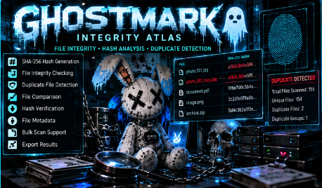

<!-- GLITCHBYTE-UPLOAD-DOOR:START -->
<div align="right"><a href="https://github.com/Hellfire13666/glitchbyte-phantom-labs/upload/main"></a></div>
<!-- GLITCHBYTE-UPLOAD-DOOR:END -->

# 🌹 GHOSTMARK INTEGRITY ATLAS // LOCAL FILE CONSTELLATION

<!-- GLITCHBYTE-ART-COVER:START -->



<!-- GLITCHBYTE-ART-COVER:END -->

**⚡ NO-DOWNLOAD-ATTACHMENT QUICK START:** [Copy one terminal command, generate HTML and open Firefox](../COPY_PASTE_OPEN.md). No Git pull, merge or rebase. The command is hosted in our GitHub lab and uses its own safe home folder.

**⚡ HOW TO TRIGGER THIS TOOL:** Clicking GitHub's source link only displays code. To **run the program and open Firefox**, [open the one-paste launcher instructions](../COPY_PASTE_OPEN.md#-how-visitors-actually-trigger-a-tool), copy the complete Bash command for this tool, paste it into an **Linux terminal**, and press **Enter**. Wait for the local `[REPORT]` HTML path. Firefox opens automatically if installed; otherwise open that saved HTML path manually. These are not one-click GitHub apps, and typing a tool name alone is not a shell command.


**Independent Python 3 • Offline SHA-256 hashing • Duplicate detection • Baseline change reports • Rosie Firefox dashboard**

[Source](../../tools/ghostmark_integrity_atlas.py) · [Tests](../../tests/test_ghostmark_integrity_atlas.py) · [Tool Vault](../TOOL_VAULT.md)

GHOSTMARK turns a *local folder you choose* into a read-only fingerprint atlas. It hashes files, groups byte-for-byte identical content (by SHA-256), and optionally compares paths and digests against an earlier exported JSON manifest. No file contents leave your computer, no file deletion, and no network calls are made by the tool. File names and fingerprints in the exported reports may themselves be sensitive; keep the reports private.

## Real CLI controls

| Option | Function |
| --- | --- |
| `--demo` | Three harmless synthetic files in a temporary folder |
| `--folder PATH` | Inspect a chosen local folder, read-only |
| `--baseline report.json` | Compare against a prior snapshot of the same folder |
| `--max-files 5000` | Stop after this many successfully hashed files |
| `--max-mb 100` | Skip files larger than the per-file MiB cap |
| `--out PATH` | HTML and JSON output folder |
| `--artwork PATH` | Optional Rosie PNG/JPEG in the dashboard header |
| `--no-browser` | Save reports without launching Firefox |

Default report folder: `~/GhostmarkAtlasReports`. Outputs have distinct filenames to preserve previous scans. Symlinks are skipped. Scans may be partial when access, size or file-count limits are hit. A hash match is evidence of identical observed content, not ownership or attribution.

## 📋 COPY & PASTE BUILD RECIPE // LINUX BASH

**INSTALL → BUILD → TEST → RUN → FIND/READ RESULTS → TROUBLESHOOT**

This recipe was checked using an isolated Linux test environment with the public GitHub URL redirected to the CI checkout for reproducible offline verification. Normal first-time `git clone` requires GitHub access. It does not merge, reset, or delete your existing local projects, and contains no `exit` commands.

```bash
# 🌹 GHOSTMARK // SAFE FIRST-RUN OFFLINE DEMO
command -v python3 >/dev/null 2>&1 && echo "Python 3 found"
command -v git >/dev/null 2>&1 && echo "Git found"

STATION="$(pwd)/ghostmark-station"
mkdir -p "$STATION"
cd "$STATION"

# Dedicated checkout, separate from your existing diverged local repository.
if [ ! -d glitchbyte-phantom-labs ]; then
    git clone https://github.com/Hellfire13666/glitchbyte-phantom-labs.git
fi

SCRIPT="$STATION/glitchbyte-phantom-labs/tools/ghostmark_integrity_atlas.py"
REPORT_DIR="$STATION/reports"

# BUILD: Check the actual Python source without creating compiled artifacts.
python3 - "$SCRIPT" <<'PY'
from pathlib import Path
import sys
source = Path(sys.argv[1])
compile(source.read_bytes(), str(source), "exec")
print("PASS: GHOSTMARK Python 3 syntax")
PY

# TEST: Actual arguments supported by the real tool.
python3 "$SCRIPT" --help

# RUN: Real SHA-256 hashes of three disposable synthetic example files.
python3 "$SCRIPT" --demo --no-browser --out "$REPORT_DIR" \
    --artwork "$STATION/glitchbyte-phantom-labs/artwork/labface2.png"

# FIND AND READ: Assert a genuine identical-content pair and HTML export.
python3 - "$REPORT_DIR" <<'PY'
from pathlib import Path
import json
import sys
folder = Path(sys.argv[1])
records = list(folder.glob("ghostmark_*.json"))
assert records, "No JSON report found"
data = json.loads(records[-1].read_text(encoding="utf-8"))
assert len(data["files"]) == 3, "Expected three demo files"
assert len(data["duplicates"]) == 1, "Expected one matching-content group"
html_path = records[-1].with_suffix(".html")
assert html_path.exists(), "No HTML dashboard found"
assert "GHOSTMARK" in html_path.read_text(encoding="utf-8")
print("PASS: real SHA-256, duplicate grouping and saved Firefox dashboard")
print("REPORT:", html_path)
PY

# SHOW: Open Firefox automatically when installed on a graphical desktop.
if command -v firefox >/dev/null 2>&1; then
    LATEST=$(find "$REPORT_DIR" -maxdepth 1 -name 'ghostmark_*.html' -type f -printf '%T@ %p\n' | sort -nr | head -n 1 | cut -d' ' -f2-)
    if [ -n "$LATEST" ]; then firefox "$LATEST" >/dev/null 2>&1 & fi
fi
```

## Scan a folder you own, then compare changes

Run these commands inside the `ghostmark-station` project directory created above. The baseline filename shown is a placeholder, not an existing file.

```bash
SCRIPT="./glitchbyte-phantom-labs/tools/ghostmark_integrity_atlas.py"
mkdir -p ./sample-files ./reports
python3 "$SCRIPT" --folder ./sample-files --out ./reports
# For a later comparison, substitute the actual first report file:
python3 "$SCRIPT" --folder ./sample-files \
  --baseline ./reports/REPLACE_WITH_PREVIOUS_REPORT.json \
  --out ./reports
```

**Read-only boundary:** It never edits, removes, or uploads originals. It excludes its own report folder when nested inside your chosen input folder. It will still read and hash your requested documents and disclose *their names* in the local report, so choose folders intentionally. A changed file during hashing is omitted rather than reported as a trustworthy fingerprint. It does not follow symlinks and does not assert malware or tampering without an earlier known-good baseline.

## 🛠️ Troubleshooting

- **Missing Git or Python 3:** Install Git and Python 3 on Linux.
- **Git repository diverged:** Use the independent `PhantomLabsBuilds/ghostmark-station` checkout. Do not reset your main workspace.
- **Folder not found or unreadable:** Supply a valid local path you own with read permissions.
- **No Firefox:** Open the printed HTML path manually.
- **Symlink skipped:** Intentional; this tool does not follow symlinks.
- **Skipped big files:** Increase `--max-mb` intentionally after checking available time and disk access.
- **Change comparison says folder mismatch:** Use a baseline made from the *same resolved folder path*.
- **No duplicates found:** A matching hash is required; similar filenames do not imply identical content.
- **Reports contain sensitive paths:** Keep exports local/private.

### Testing limits

[Offline tests](../../tests/test_ghostmark_integrity_atlas.py) check actual SHA-256 scans, duplicate detection, baseline adds/removals/changes, symlink handling, file-size boundaries, report escaping, unique exports and CLI errors. CI also runs the published Bash block in a disposable clean HOME. This does not provide antivirus or forensic chain-of-custody guarantees.

[License notice](../../LICENSE-NOTICE.md) · [Security policy](../../SECURITY.md)

## 💾 Easy Save: `-o name.txt` or `--o name.txt`

Get the [Phantom Easy Save runner](../EASY_SAVE_ALL_TOOLS.md) first. The runner can save this tool's **printed terminal output** in a new plain-text file without changing its own CLI; `-o` and `--o` work **on the runner before the `--` separator**.

```bash
SAVER="./easy-save/phantom_easy_save.py"
# From the HQ repository root, after installing the Easy Save runner here:
python3 "$SAVER" -o ghostmark_help.txt -- python3 -u tools/ghostmark_integrity_atlas.py --help
```

This example saves **help text**, not working results. For actual output, substitute this tool's real run command and tested arguments from the setup recipe above for everything after the separator, and choose a new `.txt` filename. The runner saves terminal text only, not its native HTML/JSON/CSV; this tool's pre-existing report/export behavior is unchanged, so it may still write its original files. Terminal-interactive or Firefox-only behavior may require a native exporter. New projects get `-o`/`--o` implemented in their own CLI when practical.

