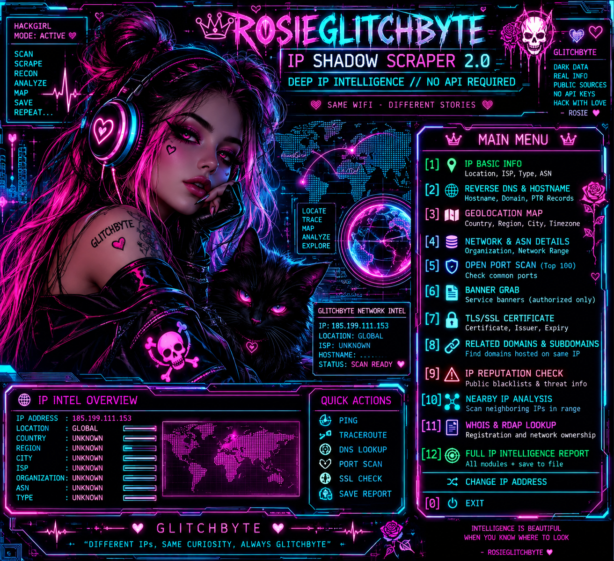

<!-- GLITCHBYTE-UPLOAD-DOOR:START -->
<div align="right"><a href="https://github.com/Hellfire13666/glitchbyte-phantom-labs/upload/main"></a></div>
<!-- GLITCHBYTE-UPLOAD-DOOR:END -->

# 🌘 ROSIEGLITCHBYTE IP SHADOW SCRAPER // TOOL SHOWCASE



**Python 3 · IP intelligence & local classification · JSON reports · Standard library**

[Source](../../tools/rosie_ip_shadow_scraper.py) · [Tool Vault](../TOOL_VAULT.md) · [Starter guide](../TOOL_STARTER_GUIDE.md)

> Public signals, carefully labeled. A network address is not proof of someone's identity.

## Actual existing modes

| Mode | Function | Network activity |
| --- | --- | --- |
| `1` | IP classification (IPv4/IPv6 flags) | **None** |
| `2` | Reverse DNS / PTR | DNS lookup |
| `3` | Public RDAP allocation data | External request for global IPs |
| `4` | Network-prefix context | **None**, not a subnet scan |
| `5` | TLS handshake/certificate SHA-256 fingerprint | Connects to TCP 443 |
| `6` | HTTPS HEAD headers | **Requires interactive authorization confirmation** |
| `7` | HTTP HEAD headers | **Requires interactive authorization confirmation** |
| `8` | VirusTotal, AbuseIPDB, ARIN, RIPEstat research URLs | **None**; links only, no verdict |
| `9` | Combined classification, PTR, RDAP, network context, TLS and links | **May contact public services and target TCP 443** |

Mode `9` is labeled “passive” in the existing interface but **includes a TLS connection**, so it is not entirely offline or passive. HTTP HEAD modes do not collect response cookies. The script's TLS function uses a default verifying SSL context and passes the IP as the certificate verification identity; many sites have certificates for hostnames rather than IPs and can fail validation. Errors are recorded rather than disabling certificate validation.

The [repository security policy](../../SECURITY.md) was corrected in Phase 24 to reflect the verifying TLS context. Offline mocked regression tests cover the configuration, but authorized live certificate verification and a full security review remain outstanding. Do **not** regard this documentation review as a formal security audit.

## 📋 COPY & PASTE BUILD RECIPE // Ubuntu/Linux Bash

**Install → Build → Test → Run → Find Results → Troubleshoot.** This first-run recipe performs only local classification of reserved documentation IP `192.0.2.1`. The initial Git clone needs internet, but the tool makes **no DNS, HTTP or TLS requests in mode 1**.

```bash
# PHANTOM LABS // IP SHADOW SCRAPER first-run recipe
set -e

# 1. INSTALL
command -v python3 >/dev/null 2>&1 || { echo "Python 3 is required."; exit 1; }
command -v git >/dev/null 2>&1 || { echo "Git is required."; exit 1; }
WORKSPACE="$HOME/PhantomLabsBuilds/ip-shadow-station"
mkdir -p "$WORKSPACE"
cd "$WORKSPACE"
if [ ! -f glitchbyte-phantom-labs/tools/rosie_ip_shadow_scraper.py ]; then
  if [ -e glitchbyte-phantom-labs ]; then
    echo "A different folder already exists. Inspect it; nothing was overwritten."
    exit 1
  fi
  git clone https://github.com/Hellfire13666/glitchbyte-phantom-labs.git
fi

# 2. BUILD: standalone Python; no pip packages or compiler needed.
python3 --version

# 3. TEST: source syntax and real CLI flags, without connecting to a target.
python3 -m py_compile glitchbyte-phantom-labs/tools/rosie_ip_shadow_scraper.py
python3 glitchbyte-phantom-labs/tools/rosie_ip_shadow_scraper.py --help

# 4. RUN: offline IP classification of a reserved example address.
python3 glitchbyte-phantom-labs/tools/rosie_ip_shadow_scraper.py \
  192.0.2.1 --mode 1

# 5. FIND RESULTS: exact output directory configured by the program.
REPORT_DIR="$HOME/RosieGlitchByte_IP_Shadow_Reports"
find "$REPORT_DIR" -maxdepth 1 -type f -name 'rosie_ip_192.0.2.1_*.json' -print
echo "Open the actual saved file with: python3 -m json.tool /actual/path.json"
```

The source saves a JSON report after each completed mode under `~/RosieGlitchByte_IP_Shadow_Reports/`. Names follow `rosie_ip_<IP>_<UTC YYYYMMDD_HHMMSS_microseconds>_<random-suffix>.json` (IPv6 colons become underscores). The microsecond clock plus random suffix protects earlier reports from rapid reruns. The tool does **not** offer `--output`, CSV or HTML exports.

### Run other modes only when appropriate

For an IP address you own or have a legitimate reason to examine, first substitute its actual public address:

```bash
cd "$HOME/PhantomLabsBuilds/ip-shadow-station"
python3 glitchbyte-phantom-labs/tools/rosie_ip_shadow_scraper.py \
  YOUR_AUTHORIZED_IP --mode 2
```

Other flags include `--mode 1` through `--mode 9` and `--art`. The optional art command now resolves the original `artwork/rosie_ip_shadow_art.png` from the repository root. The approved image was not moved or edited. On a headless Linux system, `xdg-open` may still be unavailable.

HTTP/HTTPS HEAD modes `6` and `7` prompt for explicit confirmation. Only proceed when you have permission. Never assume that the presence of a public IP, a reputation link or an RDAP registration proves an allegation about an individual.

## 📊 Read the JSON

```bash
find "$HOME/RosieGlitchByte_IP_Shadow_Reports" -type f -name '*.json'
python3 -m json.tool "/full/path/to/the_actual_report.json" | less
```

The output contains `brand`, `timestamp_utc` and a `results` object keyed by the selected research module. External lookups may report errors, redacted records or missing data.

## 🛠️ Troubleshooting

| Situation | Check |
| --- | --- |
| `python3` or `git` missing | Install using your Linux distribution's package manager |
| Invalid input | Provide one IPv4/IPv6 address, not a hostname or URL |
| No JSON report | Use a valid mode, inspect terminal `Saved report:` and the home directory path |
| Missing artwork | Ensure the checkout contains the existing `artwork/rosie_ip_shadow_art.png`; no image duplication is required |
| Reverse DNS returns no hostname | Normal for many addresses; not proof of wrongdoing |
| TLS certificate mismatch | A hostname certificate may not validate against an IP; don't disable verification |
| RDAP unavailable | Network/service errors or private addresses may prevent a result |
| Authorization confirmation declined | HEAD request modes are skipped intentionally |
| Same-second rerun | Copy earlier JSON before running again if retaining it matters |

## 🧪 Verification and safety

Prepared after inspecting [the current Python source](../../tools/rosie_ip_shadow_scraper.py). The full Bash recipe has **not been executed end-to-end in Ubuntu**, and no external target was queried during this documentation update. Source inspection is not a security audit.

Check [SECURITY.md](../../SECURITY.md) and the [custom source-available license](../../LICENSE-NOTICE.md) before using or sharing this tool. Do not commit private reports, credentials, sessions or personal data.

[← Tool Vault](../TOOL_VAULT.md) · [← Official homepage](../../README.md)
