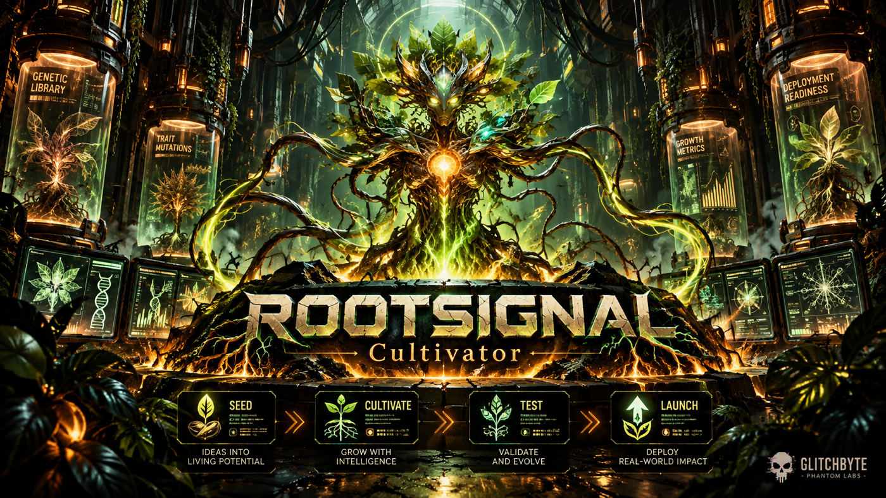

<div align="right"><a href="https://github.com/Hellfire13666/rootsignal-cultivator-2026/upload/main"></a></div>

# 🌱 RootSignal Cultivator v1.0.0 | The Cultivation Room engine



*Selected GlitchByte Phantom Labs artwork. Biotech interfaces are conceptual, not live RootSignal output.*

**Status (October 19, 2026): tested on Linux and committed to its [dedicated PRIVATE source repository](https://github.com/Hellfire13666/rootsignal-cultivator-2026).** GitHub independently confirmed private visibility, a `main` release commit, README, manifest, Python source, tests and [custom copper/lime terrarium artwork](https://github.com/Hellfire13666/rootsignal-cultivator-2026/blob/main/art/rootsignal_terrarium.png). These private links require collaborator access. **No public code mirror or Backup HQ archive is implied.**

**Glitch HEX visual identity:** copper + amber + acid lime + deep charcoal. The terminal presents real locally generated seed IDs and stage outcomes, not invented provider data. **SEED → CULTIVATE → TEST → LAUNCH** is the tool's design cycle, not a promise of automatic software certification.

## Real working tools and permissions

- **Python 3 / Linux, standard library only:** `rootsignal/rootsignal_cultivator_v1_0.py`.
- **Launcher:** `open_rootsignal.sh` is a Bash wrapper to the Python entry point.
- **Actions:** `demo` (synthetic/no changes), `seed` (write a private seed), `list` (show seed registry), `nurture` (update an existing seed), `sprout` (create a distinct new Python scaffold), `report` (print or opt-in save Markdown).
- **Privacy:** new registry dirs `0700`, registry files and opt-in reports `0600`, reject symlink targets and existing report destinations. Project scaffolds are separately named and refuse overwrites. No network operations, hidden saving or Firefox launch.
- **Tests:** release checks verified the ZIP with `sha256sum -c`, verified archive structure, extracted to a versioned release directory and passed **16/16 offline tests**, then ran the no-write synthetic demo. No real live-data tests are relevant; its core functions are offline.

## Install (source-only ZIP release)

Use your existing private `rootsignal-cultivator-v1.0.0.zip` and its matching `.sha256` sidecar. Preserve the original prototype and do not extract over unrelated folders. On Linux:

```bash
cd /path/to/release-files &&
sha256sum -c rootsignal-cultivator-v1.0.0.sha256 &&
unzip -tq rootsignal-cultivator-v1.0.0.zip &&
mkdir -p ./rootsignal-install &&
unzip -n rootsignal-cultivator-v1.0.0.zip -d ./rootsignal-install &&
cd /path/to/release-files/rootsignal-install/rootsignal-cultivator-v1_0_0
bash open_rootsignal.sh --help
```

**Installation already passed on the existing installation. Do not reinstall unless intentionally restoring.** Dependency: Python 3 and Bash; `unzip` for the archive. The original `cultivation_room_seedbed_2026.zip` remains untouched.

## 🌱 SIMPLE | Synthetic preview, no saves

```bash
cd /path/to/release-files/rootsignal-install/rootsignal-cultivator-v1_0_0
bash open_rootsignal.sh demo
```

Expected: a colorful RootSignal banner, SEED/ROOT/GROW/TEST/BLOOM explanations, and `[DEMO] SYNTHETIC ONLY | NO FILES | NO NETWORK | NO REGISTRY CHANGES`. **Verified in a prior Linux test.**

## ⚡ MEDIUM | Seed a new idea, list, print status

```bash
cd /path/to/release-files/rootsignal-install/rootsignal-cultivator-v1_0_0
DATA="./rootsignal-data/seeds.json"
python3 -B rootsignal/rootsignal_cultivator_v1_0.py --db "$DATA" --color always seed 'Copper Fern Terminal' --category creative-python --tags 'offline,terminal'
python3 -B rootsignal/rootsignal_cultivator_v1_0.py --db "$DATA" --color always list
python3 -B rootsignal/rootsignal_cultivator_v1_0.py --db "$DATA" --color always report
```

Expected: a **real** newly assigned seed ID; list prints existing seed entries; plain report prints stage tally and `[SAVE OFF]`. Creating a seed **does save** a private JSON registry, while list and default report do not export reports. Use a new seed name if the example already exists.

## 🔥 EXTRA | Grow one distinct starter and export privately

Replace `YOUR_SEED_ID` with the exact ID printed by the MEDIUM recipe.

```bash
cd /path/to/release-files/rootsignal-install/rootsignal-cultivator-v1_0_0
DATA="./rootsignal-data/seeds.json"
python3 -B rootsignal/rootsignal_cultivator_v1_0.py --db "$DATA" --color always sprout YOUR_SEED_ID
python3 -B rootsignal/rootsignal_cultivator_v1_0.py --db "$DATA" --color always nurture YOUR_SEED_ID --stage testing --note 'Local smoke check passed'
python3 -B rootsignal/rootsignal_cultivator_v1_0.py --db "$DATA" --color always report -o "./rootsignal-data/rootsignal-growth-v1-$(date +%s).md"
```

Expected: a new a dedicated projects directory scaffold with `src/main.py` and tests; updating the stage changes the registry; optional `-o` writes an exclusively created private Markdown report. If a report filename already exists, choose a new name. `--o` and `--out` are supported aliases. Scaffolds and save behavior are covered by the release unit tests; **separate execution verification of MEDIUM/EXTRA exact commands remains a distinct optional check**.

## Troubleshooting / accuracy

- Do **not** run `scripts/publish_private_rootsignal.sh` again: if `.git` exists it intentionally prints `[STOP] Existing Git repository. No changes made`. The **dedicated private GitHub source repository exists** and its source is present. This is not a failed install.
- A refused registry or report directory usually means insecure preexisting permissions; review its path instead of globally applying `chmod` to unrelated files. Existing output files are intentionally not overwritten.
- Never commit real seed registries or private notes. GitHub visibility `private` was directly verified, but the existence of a private source repo does not prove an independent off-device encrypted backup.
- Frozen v1.0.0 ZIP/checksum and `RELEASE_MANIFEST.json` describe the archived release; later GitHub documentation-only edits must not silently change historical checksums.

**Pending:** independent clean clone, optional version tag and GitHub Release, visibility-matched off-device recovery snapshot. These are distinct from source-publication and the 16 passing tests.

**Lab navigation:** [HQ](../../README.md) · [Cultivation Room](../CULTIVATION_ROOM.md) · [Tool Vault](../TOOL_VAULT.md) · [Ecosystem](../ECOSYSTEM.md) · [Mandatory Build Charter](../PHANTOM_LABS_MANDATORY_BUILD_CHARTER.md) · [RIFTSEAL](RIFTSEAL.md) · [Private RootSignal source](https://github.com/Hellfire13666/rootsignal-cultivator-2026).
