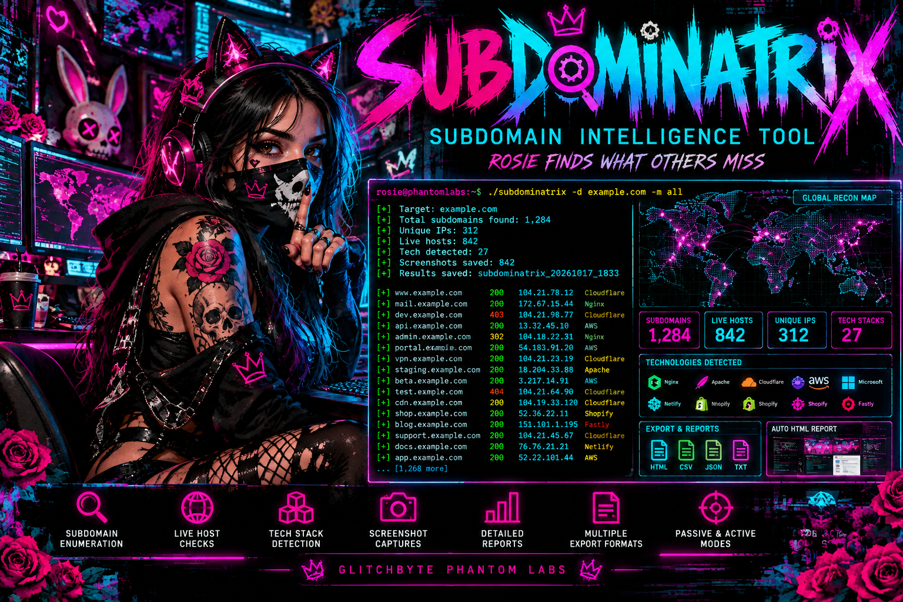
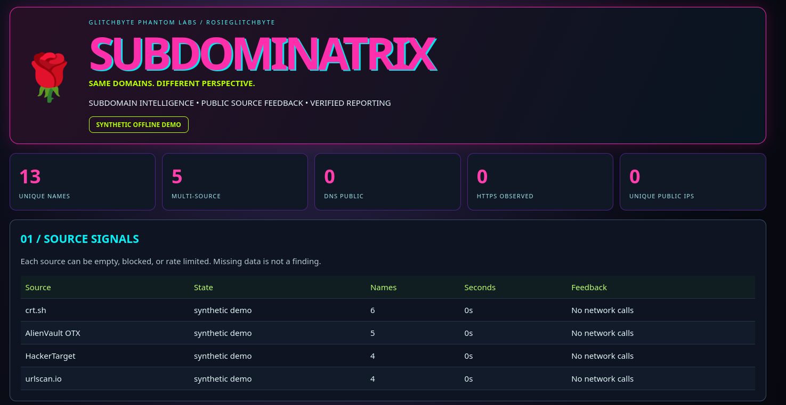

<!-- GLITCHBYTE-UPLOAD-DOOR:START -->
<div align="right"><a href="https://github.com/Hellfire13666/glitchbyte-phantom-labs/upload/main"></a></div>
<!-- GLITCHBYTE-UPLOAD-DOOR:END -->

# 🌹👻 SUBDOMINATRIX // ROSIE'S SUBDOMAIN INTELLIGENCE RIOT

**Same domains. Different perspective.** Multi-source public subdomain reconnaissance and reporting by GlitchByte Phantom Labs.





**Official SUBDOMINATRIX artwork:** Both Rosie-themed pictures above are stored in this repository and displayed on this tool page. They are promotional illustrations, not live scanner screenshots. The statistics, maps, sample hostnames and command-like text depicted in the artwork are illustrative; use the verified commands below to run the actual tool. Real reports contain observed records or clearly labeled synthetic demo data.

[Python 3 source](../../tools/subdominatrix.py) · [Offline tests](../../tests/test_subdominatrix.py) · [One-paste launcher page](../COPY_PASTE_OPEN.md) · [Full Tool Vault](../TOOL_VAULT.md)

## What the actual tool does

- **Four public passive sources:** crt.sh certificate-transparency entries; AlienVault OTX passive DNS; HackerTarget hostsearch; and urlscan.io public observations. Their free endpoints can be rate-limited, empty, or unavailable, and the report says so.
- **Optional installed Subfinder and Findomain:** Use `--subfinder` and `--findomain` to run local executables; not bundled or installed. Missing tools do not stop the passive public-source scan.
- **Normalization and source attribution:** Keep only syntactically valid DNS names ending in the exact target domain; deduplicate across sources; indicate overlaps.
- **Opt-in DNS checking:** `--dns-check` checks at most `--max-verify` selected names with an 8-worker ceiling and records public vs reserved/private address observations.
- **Opt-in HTTPS headers:** `--http-check` together with `--dns-check` performs **one** bounded HEAD request over verified TLS per checked public hostname, using a validated public IP and hostname verification. It does not follow redirects or crawl links.
- **Technology clues:** A small set of hints inferred from HTTPS response headers only, not a comprehensive stack analysis and not a security-risk score.
- **Four saved outputs:** Neon HTML with client-side filtering, JSON, CSV, and TXT; unique output names preserve earlier reports.
- **Source-by-source feedback:** Name counts, status, elapsed seconds and error reasons so viewers can tell unavailable data from zero discoveries.
- **Offline demo:** Clearly marked synthetic names under `example.com`; **no external requests or optional CLI calls**.

**Not in this release:** global asset geolocation, screenshots, automatic technology fingerprints beyond selected headers, vulnerability scoring, login automation, unlimited crawling, brute-force enumeration, or automatic ownership attribution. These appear only as design directions in the concept picture, not as implemented features.

## 🧪 COPY & PASTE BUILD RECIPE // Ubuntu/Linux first run

**Install → Build → Test → Run → Find results → Troubleshoot.** The first Bash block is independently exercised in Linux CI under a disposable home folder. It generates an **offline synthetic preview**, not a live scan. It uses a dedicated checkout and does not alter a user's original Git clone.

```bash
# 🌹 SUBDOMINATRIX • GUARANTEED NO-LIVE-LOOKUP DEMO
command -v python3 >/dev/null 2>&1 && echo "Python 3 found"
command -v git >/dev/null 2>&1 && echo "Git found"

STATION="$HOME/PhantomLabsBuilds/subdominatrix"
mkdir -p "$STATION"
cd "$STATION"

# Install source in an independent folder, without git pull, merge, reset or exit.
if [ ! -d glitchbyte-phantom-labs ]; then
    git clone https://github.com/Hellfire13666/glitchbyte-phantom-labs.git
fi

SCRIPT="$STATION/glitchbyte-phantom-labs/tools/subdominatrix.py"
OUTPUT="$STATION/reports"

# Verify Python source syntax before running anything.
python3 - "$SCRIPT" <<'PY'
from pathlib import Path
import sys
path = Path(sys.argv[1])
compile(path.read_bytes(), str(path), "exec")
print("PASS: SUBDOMINATRIX Python 3 source syntax")
PY

# Verify documented flags.
python3 "$SCRIPT" --help

# Create real JSON, CSV, TXT, and HTML from synthetic demonstration names.
python3 "$SCRIPT" example.com --offline-demo --no-open \
  --artwork "$STATION/glitchbyte-phantom-labs/artwork/labface2.png" \
  --out "$OUTPUT"

# Confirm all four output types really exist and demo state is explicit.
python3 - "$OUTPUT" <<'PY'
from pathlib import Path
import json
import sys
folder=Path(sys.argv[1])
files=list(folder.glob("subdominatrix_*.json"))
assert files, "No JSON report generated"
data=json.loads(files[-1].read_text(encoding="utf-8"))
assert data["mode"]=="SYNTHETIC OFFLINE DEMO"
assert data["stats"]["names"]>=10
for extension in (".html", ".csv", ".txt"):
    assert files[-1].with_suffix(extension).is_file(), "Missing " + extension
print("PASS: SUBDOMINATRIX offline intelligence preview")
print("HTML:",files[-1].with_suffix(".html"))
PY

# Open the newly generated HTML in Firefox if installed.
if command -v firefox >/dev/null 2>&1; then
    LATEST=$(find "$OUTPUT" -maxdepth 1 -name 'subdominatrix_*.html' -type f -printf '%T@ %p\n' | sort -nr | head -n 1 | cut -d' ' -f2-)
    if [ -n "$LATEST" ]; then firefox "$LATEST" >/dev/null 2>&1 & fi
fi
```

### 🕷️ One-paste launcher, once the PR is merged

GitHub source links **do not execute Python**. Copy this *whole* block into the Ubuntu terminal, press Enter, and wait for the reported local HTML path. Firefox opens automatically if installed. This uses an isolated `~/PhantomLabsLaunchers` directory, not any old Git checkout.

```bash
mkdir -p "$HOME/PhantomLabsLaunchers" && curl -fL --retry 2 "https://raw.githubusercontent.com/Hellfire13666/glitchbyte-phantom-labs/main/scripts/phantom_quickopen.py" -o "$HOME/PhantomLabsLaunchers/phantom_quickopen.py" && python3 "$HOME/PhantomLabsLaunchers/phantom_quickopen.py" subdominatrix
```

**This exact launcher works on the GitHub main branch only after the release PR is merged.** An unmerged branch's URL cannot be downloaded from `/main/`. The standalone full recipe above also requires the release's source to be on main. Do not run pictured/mock installation commands from the promotional design.

### Real authorized research with Subfinder and Findomain

Only perform DNS and HTTP checks for domains you own or have permission to inspect. For public passive collection, supply a real public DNS domain:

```bash
SCRIPT="$HOME/PhantomLabsBuilds/subdominatrix/glitchbyte-phantom-labs/tools/subdominatrix.py"
python3 "$SCRIPT" example.com --subfinder --findomain \
  --dns-check --http-check --max-verify 40 --max-results 800
```

The `subfinder` and `findomain` binaries are optional; they must already be installed. The tool does **not** install them. Try `python3 "$SCRIPT" --help` for all verified flags.

### 🛠️ Troubleshooting

- **404 from curl:** The launcher PR has not merged to main, the link is wrong, or GitHub is unreachable. Don't delete or reset your existing checkout.
- **Firefox does not appear:** Test `firefox https://example.com`. Copy the printed absolute HTML report path into Firefox manually if needed.
- **Typing `subdominatrix` returns command not found:** This is a Python script, not an installed shell executable. Run the complete launcher block or `python3 "$SCRIPT" ...`.
- **No subdomains found:** Providers are rate-limited, unavailable, or don't have records; inspect the source feedback table.
- **Findomain/Subfinder missing:** Skip those flags or install the official programs separately. Passive services remain available.
- **HTTPS returns 'failed':** Certificate validation, site reachability, or HEAD support can fail; absence is not proof of weakness.
- **Demo looked too successful:** Demo results are fabricated **only for offline visualization**, never displayed as live findings.
- **Need screenshots or global map:** Not yet implemented; the poster is a concept, not tool output.

### Verification and limitations

[Tests](../../tests/test_subdominatrix.py) cover input scope, source parsers using mocked public services, demo rendering, saved formats, HTML injection escaping, limited DNS/HTTPS options, and rejecting reserved IPs. CI checks the full terminal recipe without hitting real third-party websites. **Live provider availability, data accuracy, and optional Subfinder/Findomain versions are not certified by offline tests.**

[Source-available license](../../LICENSE-NOTICE.md) · [Security guidelines](../../SECURITY.md)
